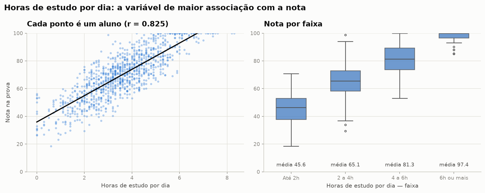
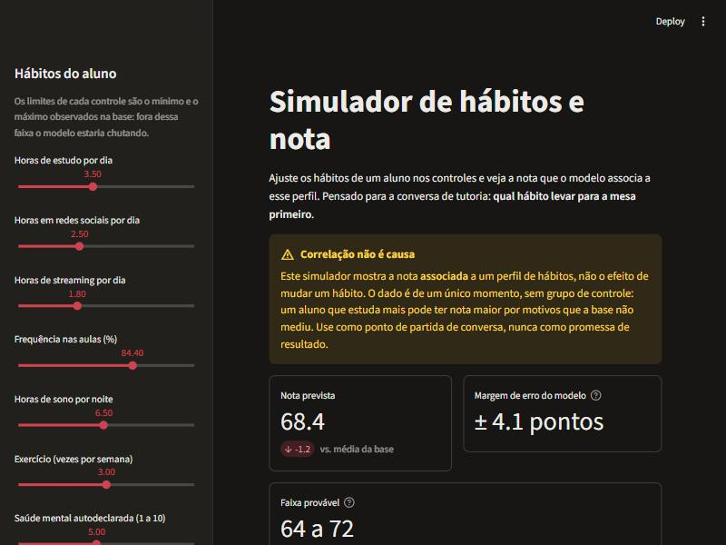

# Hábitos e desempenho estudantil

A Klubi me mandou um CSV com 1000 alunos: quanto cada um estuda por dia, quanto
tempo passa em rede social e streaming, quanto dorme, com que frequência se
exercita, como avalia a própria saúde mental — e a nota que tirou na prova.

Teste prático de Analytics Engineer (estágio), por Leandro Sato. O enunciado
original está [aqui](https://github.com/somosbro/data-analysis-challenge-klubi).

> **Antes de qualquer coisa:** tudo o que você vai ler é **associação, não
> causa**. Os dados são de um único momento, sem grupo de controle e sem nada
> sorteado — então nenhuma linha deste repositório afirma que mudar um hábito
> *provoca* mudança na nota. Eu repito isso em vários lugares, de propósito.

## O que eu encontrei



### Estudar é o que mais pesa, e com uma folga enorme

Horas de estudo por dia têm correlação de **0,825** com a nota. Para dar
dimensão: a segunda colocada tem 0,32. No modelo, cada hora a mais está associada
a **+9,5 pontos**. Olhando por faixa fica ainda mais claro — quem estuda até 2h
por dia tira 45,6 em média; quem estuda 6h ou mais tira 97,4.

### Tempo de tela só faz sentido somado

Redes sociais e streaming aparecem separados na base, e separados cada um tem uma
correlação fraca com a nota (−0,167 e −0,172). Mas quando eu somei os dois numa
coluna só, a correlação subiu para **−0,238** — mais forte que qualquer uma das
partes. Ou seja: o que compete com o estudo não é uma plataforma específica, é o
tempo de tela como um todo. Por isso as recomendações falam de "tempo de lazer em
tela", e não de "menos Instagram".

### Saúde mental é a segunda força, e a mais delicada de interpretar

É a segunda maior influência (r = 0,322) e a **única** variável que separa grupos
de forma estatisticamente significativa: quem se avalia mal tira 63,4 em média,
quem se avalia bem tira 75,9 — 12,5 pontos de diferença (Kruskal-Wallis,
p < 0,000001, ε² = 0,098).

Mas aqui eu seguro a mão. A escala é autodeclarada e foi medida junto com a nota.
Ir mal na prova pode muito bem piorar como o aluno avalia a própria saúde mental,
e não o contrário. Os dados não conseguem distinguir as duas coisas.

### O que eu esperava encontrar e não encontrei

**Gênero não faz diferença nenhuma.** As médias são 69,7, 69,4 e 70,7 para
Female, Male e Other — menos de um ponto entre elas, e p = 1 depois da correção
para testes múltiplos. Não é "diferença pequena": é diferença nenhuma.

Também não apareceu nada em dieta, qualidade da internet, trabalho de meio
período, atividade extracurricular e — essa foi a que mais me chamou atenção —
**escolaridade dos pais**. É a explicação pronta de sempre para desempenho
escolar, e nesta base ela não sustenta coisa alguma.

### O modelo erra pouco, e só usa comportamento

A regressão linear prevê a nota com erro médio de **±4,1 pontos** (R² = 0,90).
Para comparar: chutar sempre a nota média erraria 12,4 pontos.

O detalhe que eu acho mais interessante é a composição: o modelo final usa
**sete hábitos** e nenhuma característica fixa do aluno. Tudo o que explica a
nota ali é comportamento, não origem — e é justamente isso que torna o resultado
acionável.

### Se eu tivesse que resumir numa recomendação

Para o aluno mediano da base, trocar uma hora de rede social por uma hora de
estudo leva a previsão de 68,4 para **80,6**. É a troca mais direta de levar para
uma conversa de tutoria, porque uma hora sai de um lugar e entra no outro.

Como hipótese a testar, não como promessa. As recomendações completas, com o
tamanho de efeito de cada uma, estão em
[reports/06_insights.md](reports/06_insights.md).

## O simulador



Um ranking de correlações diz o que anda junto com nota alta. Não diz o que fazer
com um aluno específico — e foi para fechar essa lacuna que eu construí o app.

Você ajusta os hábitos de um aluno nos controles e ele mostra a nota que o modelo
associa àquele perfil, com as mudanças possíveis ordenadas pelo ganho previsto.
Quem usaria: coordenação pedagógica e tutoria. A decisão que ele apoia é **qual
hábito levar para a conversa primeiro** — e, rodando na turma inteira, qual aluno
chamar antes.

O raciocínio por trás do modelo e das escolhas está em
[reports/04_modelo.md](reports/04_modelo.md).

## O que este trabalho não consegue dizer

Prefiro deixar isso explícito a esconder no rodapé:

| Limitação | O que ela impede |
|---|---|
| **Dados de um único momento** | Impede qualquer afirmação de causa: nada foi sorteado, não há grupo de controle, e hábitos e nota foram medidos juntos. |
| **A relação pode valer ao contrário** | Ir bem na prova pode melhorar a saúde mental declarada, e quem vai bem pode se sentir mais à vontade para estudar. Os dados não distinguem. |
| **Falta o que não foi medido** | Renda, escola de origem, conhecimento prévio, qualidade do professor — qualquer um desses pode explicar parte do que aqui parece efeito de hábito. |
| **Tudo é autodeclarado** | Horas de estudo e saúde mental vêm do próprio aluno, com o viés de memória e de querer parecer bem. |
| **Efeito teto** | 48 alunos (4,8%) tiraram exatamente 100. Acima disso a nota não existe, então o modelo subestima quem já está no topo — por isso a previsão é truncada. |
| **Uma base, um contexto** | 1000 alunos, sem informação de país, instituição ou curso. Não dá para saber para quem isso generaliza. |
| **Erro de ±4,1 pontos** | Serve para orientar conversa e priorizar esforço, não para decidir a vida de um aluno. |

Para sair da correlação seria preciso outro desenho: um piloto com grupo de
comparação sorteado, ou medir os hábitos no começo do semestre e a nota no fim.
Enquanto isso não existe, o que este trabalho entrega é priorização apoiada em
evidência de associação — bem mais que palpite, bem menos que prova.

## Como rodar

Desenvolvi e testei em **Python 3.14.6**, com as versões das bibliotecas travadas
em `requirements.txt`.

```powershell
git clone https://github.com/LeandroSato/student-habits-analysis.git
cd student-habits-analysis
python -m venv .venv
.venv\Scripts\Activate.ps1
pip install -r requirements.txt
```

No Linux ou macOS, troque a ativação por `source .venv/bin/activate`.

**Gerar a análise** — lê `data/raw/` e grava os relatórios em `reports/`:

```powershell
python analysis/run_analysis.py
```

**Abrir o simulador** — sobe em http://localhost:8501:

```powershell
streamlit run app/streamlit_app.py
```

**Rodar os testes:**

```powershell
pytest
```

## Como o projeto está organizado

```
data/raw/            CSV do desafio, intacto
data/processed/      base tratada, gerada pela análise
src/                 módulos de tratamento, estatística e modelo
tests/               pytest das funções de tratamento
analysis/            script que roda tudo e grava os relatórios
app/                 simulador em Streamlit
reports/             relatório de cada etapa + figuras
docs/spec.md         escopo, decisões e porquês + lista das ferramentas usadas
                     (linguagem, bibliotecas, IA e skills) e das que ficaram de fora
```

Mantive o código de tratamento em `src/`, separado do script de análise e do app.
A razão é prática: o mesmo tratamento alimenta os relatórios **e** o Streamlit, e
assim não existe a chance de os dois divergirem.

## Os relatórios

Um por tarefa do enunciado, na ordem em que foram feitos:

| Etapa | Onde |
|---|---|
| 1. Exploração inicial e diagnóstico de qualidade | [reports/01_exploracao.md](reports/01_exploracao.md) |
| 2. Engenharia de dados (cada decisão com o motivo) | [reports/02_engenharia.md](reports/02_engenharia.md) |
| 3. Análise estatística e ranking de influência | [reports/03_estatistica.md](reports/03_estatistica.md) |
| 4. Modelo e simulador: que decisão apoia | [reports/04_modelo.md](reports/04_modelo.md) |
| 5. Visualização, com a leitura de cada gráfico | [reports/05_visualizacao.md](reports/05_visualizacao.md) |
| 6. Síntese de insights e recomendações | [reports/06_insights.md](reports/06_insights.md) |

Vale um aviso sobre eles: **nenhum número desses relatórios foi digitado por
mim**. As frases são montadas pelo código a partir dos valores calculados, então
não existe a possibilidade de um número do texto divergir do CSV — nem de o
relatório envelhecer se o tratamento mudar.
