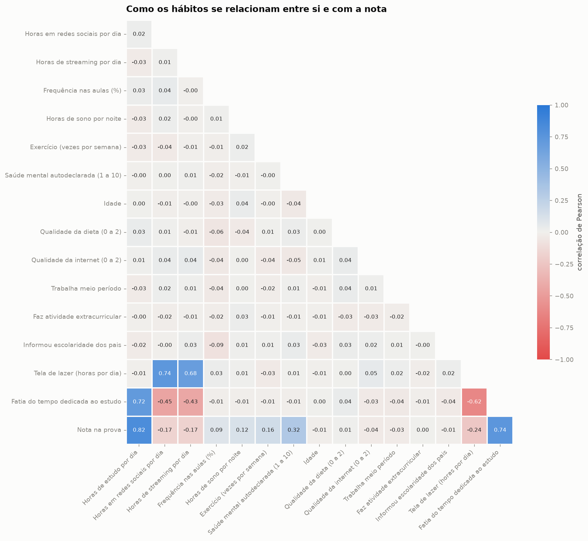
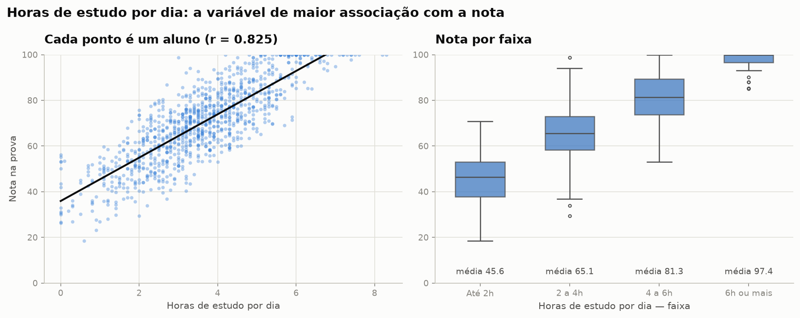
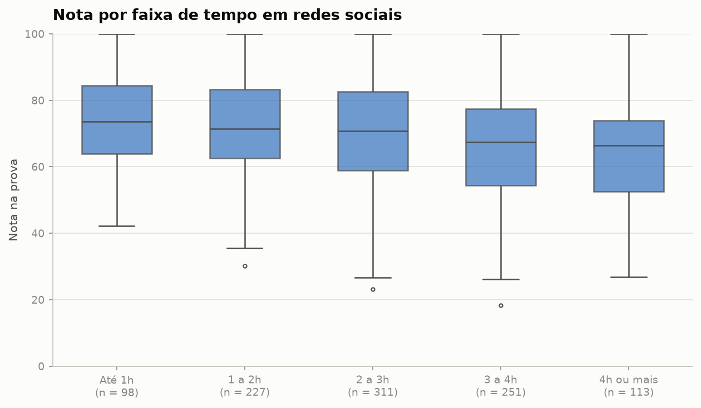
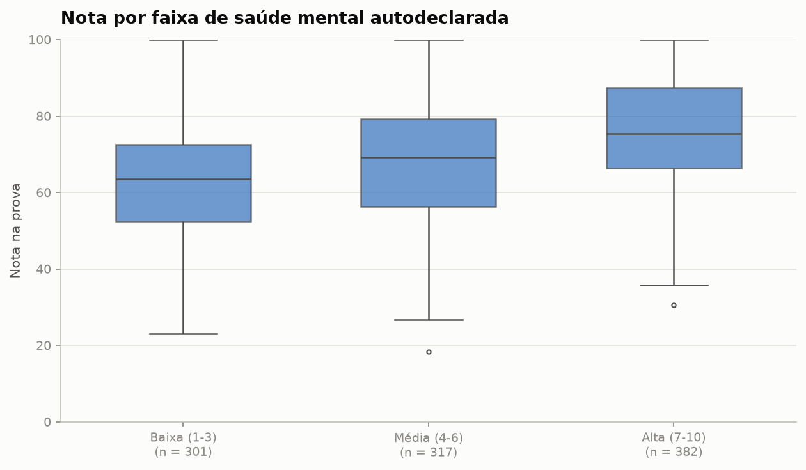
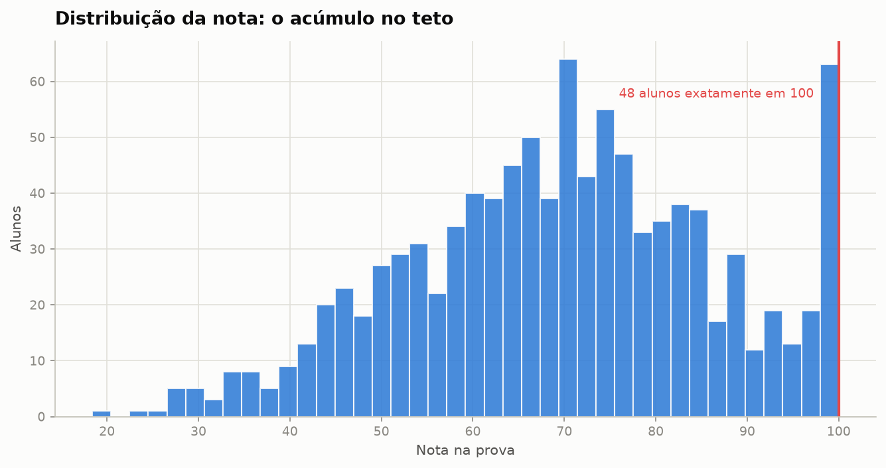
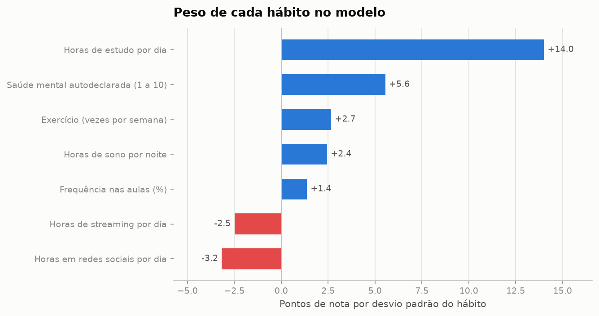

# 5. Visualização

Gerado por `analysis/run_analysis.py`. As figuras ficam em `reports/figures/` e são regeradas a cada execução.

> **Correlação não é causa.** Tudo nesta página mede se duas coisas andam juntas, nunca se uma produz a outra. O dado é observacional e de um único momento: não há grupo de controle, nada foi sorteado e qualquer relação aqui pode vir de uma terceira variável não medida, ou valer no sentido inverso.

## 5.1 Mapa de calor das correlações

Escala divergente com cinza no meio, porque correlação tem polaridade: azul para quem anda junto, vermelho para quem anda ao contrário, e o cinza marca o zero. Só o triângulo inferior — a matriz é simétrica e repetir a metade de cima dobraria a tinta sem acrescentar informação.

**O que ler aqui:** a última linha é a que importa, e nela `study_hours_per_day` se destaca sozinha (r = 0.825). O resto do mapa serve para ver que os hábitos quase não se correlacionam entre si — exceto os pares redundantes por construção já discutidos na tarefa 3, que por isso ficaram fora do modelo.

## 5.2 A variável de maior impacto, em detalhe

Dois ângulos da mesma variável, de propósito. **À esquerda**, cada aluno e a reta de tendência: mostra a dispersão real, que uma média por faixa esconde — há alunos de 2h com nota alta e alunos de 6h com nota média. **À direita**, a mesma relação por faixa, que é como a conclusão vai ser contada para quem decide.

**O que ler aqui:** Até 2h: 45.6 · 6h ou mais: 97.4 (diferença de 51.8 pontos). A subida é consistente faixa a faixa, não um salto num extremo só. A dispersão à esquerda é o lembrete de que isso é tendência de grupo, não destino de aluno.

## 5.3 Nota por faixa de redes sociais

Boxplot em vez de barra de média: a caixa mostra a mediana e onde está a metade central dos alunos, e deixa ver que as faixas se sobrepõem bastante. O tamanho de cada grupo vai no eixo, porque caixa de grupo pequeno não merece a mesma confiança e sem o número elas parecem iguais.

**O que ler aqui:** Até 1h: 74.1 · 4h ou mais: 64.2 (diferença de 9.9 pontos). A descida existe e é consistente, mas as caixas se sobrepõem — tempo de rede social separa menos os alunos do que horas de estudo, e o gráfico mostra isso melhor do que o número sozinho.

## 5.4 Nota por faixa de saúde mental

A única diferença entre grupos que sobreviveu à correção de Holm na tarefa 3, então merece figura própria.

**O que ler aqui:** Baixa (1-3): 63.4 · Alta (7-10): 75.9 (diferença de 12.5 pontos). Importante: a escala é autodeclarada e medida junto com a nota. Ir mal na prova pode afetar como o aluno avalia a própria saúde mental, então o sentido da relação não é testável com este dado.

## 5.5 A distribuição da nota, e o teto

Esta figura existe para tornar visível um problema que é fácil de ignorar numa tabela.

**O que ler aqui:** a barra colada em 100 são 48 alunos (4.8%) com a nota máxima. É o efeito teto: acima disso a nota não existe, o modelo subestima esse grupo e a previsão precisa ser truncada.

## 5.6 Peso de cada hábito no modelo

Em pontos por **desvio padrão**, não por hora: é o único jeito honesto de comparar hábitos de unidades diferentes numa figura só. Azul puxa a nota para cima, vermelho para baixo — e o sinal está também no número ao lado da barra, para que a cor não seja o único canal de leitura.

**O que ler aqui:** o peso de horas de estudo não tem concorrência. Esta é a figura para levar a uma reunião quando a pergunta for “onde a gente mexe primeiro?”.

## 5.7 Decisões de visualização

| Decisão | Por quê |
|---|---|
| matplotlib/seaborn nos relatórios, Altair no app | O README precisa de PNG que apareça no GitHub sem servidor; o app precisa de gráfico interativo. |
| Divergente só no mapa de calor | Correlação tem polaridade (-1 a +1) e pede dois tons opostos com neutro no meio. Onde há grandeza sem polaridade, uma cor só. |
| Nada de arco-íris | Matiz variável sugere categoria onde existe número contínuo, e inventa fronteiras que o dado não tem. |
| Uma série, nenhuma legenda | O título já nomeia o que está desenhado; caixa de legenda seria ruído. |
| Grade e eixos em tom fraco | A grade é referência, não conteúdo: os dados têm de ser a coisa mais escura da figura. |
| Eixo da nota fixo em 0–100 em todas as figuras | Deixar cada gráfico escolher sua escala faria diferenças pequenas parecerem grandes. |
| n de cada grupo no rótulo dos boxplots | Caixa de 26 alunos e caixa de 382 não merecem a mesma confiança. |
| Cor nunca sozinha | Onde a cor marca direção, o sinal aparece também no número — leitura não depende de enxergar a diferença entre azul e vermelho. |
